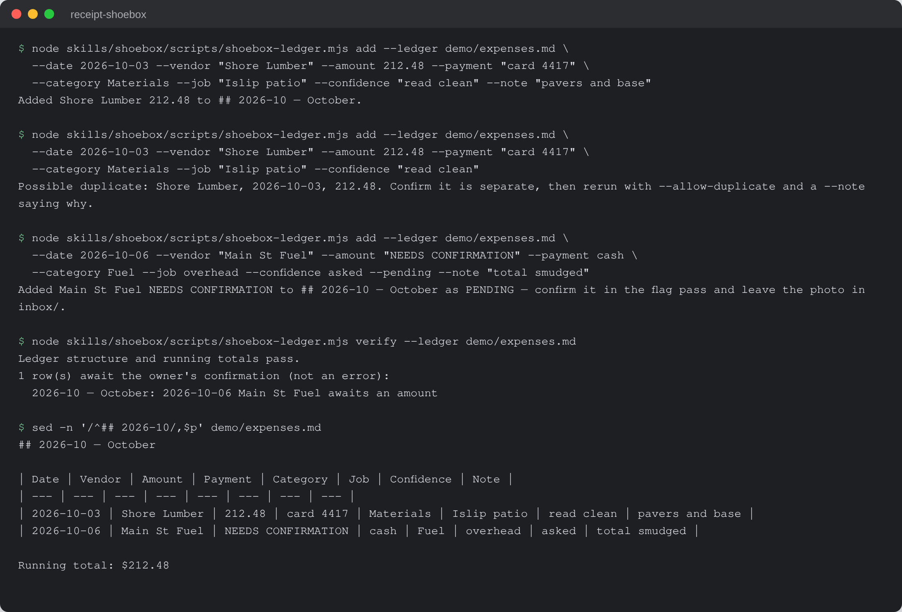

# Receipt Shoebox

Turn a pile of photographed receipts into a monthly expense ledger, an
accountant CSV and a job-costs CSV, without the AI ever guessing a dollar
amount.


-f7df1e)


## What it is

An AI skill kit for small trades, field-service and other small businesses. The
owner photographs receipts and drops the photos in an inbox folder. The AI
reads each one (vendor, date, amount, payment method, which job it was for,
and an expense category) and appends it to a dated monthly table in
`ledger/expenses.md`. At month end it produces two CSVs: the expense file for
the accountant and a job-costs file that totals spend per job. It also runs a
flag-review pass (duplicates, possible capital purchases, outliers, unreadable
receipts, money left in Uncategorized) and a short month-in-review comparison.

## Why it exists

Many small businesses keep receipts in a glovebox and type them up at month
end, if at all. A bank statement or a generic expense list does not answer the
question that matters most: how much a given job actually cost. Reading
crumpled paper is also where an AI is most tempted to guess a number, and a
guessed number in the books is worse than a blank. This kit takes the typing
off the owner's plate and keeps every money figure confirmed.

## How it works


`installer.md` is a self-adapting installer: the host AI reads it and installs
the `shoebox` skill for its platform, with a starter category list for the
owner's kind of business (trades and field service, professional services,
retail and food, or generic small business). The AI does the vision reading
and the judgment calls across four workflows: process receipts, flag review,
month-end export and month in review. One dependency-free Node script,
`skills/shoebox/scripts/shoebox-ledger.mjs`, owns the ledger append, duplicate
refusal, running-total update and ledger verification, and refuses any row
whose money is not confirmed. In a chat with no file access the kit runs from
the same instructions and states that the script-backed checks are advisory.

## Features

- Never guesses money: an unreadable total, date, vendor or payment method is
  asked about, and the row is held as `NEEDS CONFIRMATION` until answered. A
  guessed category is allowed and disclosed; a guessed amount is not.
- Every row carries a confidence note (`read clean`, `asked`, `best guess on
  category only`).
- Named refusals: an unreadable photo is refused with a concrete retake
  instruction; a receipt that could belong to two open jobs is held as
  `NEEDS JOB`; export stops while any row is unresolved.
- Duplicate refusal: a repeat of the same vendor, date and amount needs an
  explicit override and a note saying why.
- Text printed on a receipt that tries to instruct the AI is ignored and quoted
  back.
- Job costing: receipts are tied to jobs in `ledger/jobs.md`, and the job-costs
  CSV totals spend per job.
- Append-only ledger: rows are added, never rewritten.
- The ledger ships empty; the install check runs on one of the owner's own
  receipts.

## Run it locally (for review)

Requires Node 22.6 or newer. No packages, no build step.

```sh
git clone https://github.com/rodaddy/receipt-shoebox.git
cd receipt-shoebox

# Ledger script tests
node --test tests/*.test.mjs

# The ledger helper's commands and rules
node skills/shoebox/scripts/shoebox-ledger.mjs --help

# Try it on a copy of the empty starter ledger
mkdir -p demo && cp skills/shoebox/ledger/expenses.md demo/
node skills/shoebox/scripts/shoebox-ledger.mjs add --ledger demo/expenses.md \
  --date 2026-10-03 --vendor "Shore Lumber" --amount 212.48 --payment "card 4417" \
  --category Materials --job "Islip patio" --confidence "read clean"
node skills/shoebox/scripts/shoebox-ledger.mjs verify --ledger demo/expenses.md
```



*A real run of `shoebox-ledger.mjs` against a copy of the empty starter
ledger. The receipts are invented for the demo; the output is exactly what the
script printed.*

To use the kit itself, open `START-HERE.md` in your AI assistant and follow the
installer. `OPERATIONS-MANUAL.md` describes the once-a-month routine.

**Licence:** free for personal and non-commercial use with credit; commercial
use needs a licence. See [LICENSE](LICENSE) (PolyForm Noncommercial 1.0.0) or
contact rico@rtech-consulting.com.

## Repository layout

- `installer.md`, `START-HERE.md`: the self-adapting installer
- `OPERATIONS-MANUAL.md`: the once-a-month routine in plain language
- `skills/shoebox/`: the skill, workflows, config, ledger and script
- `tests/`: ledger script tests
- `tiers/`: tier notes
- `docs/images/`: README images

## How it was built

Receipt Shoebox was built in July and August 2026 as an AI skill whose first
rule is never to guess money. An internal review on 2026-08-11 found it filed a
landscaper's largest costs as uncategorized, which led to job costing. Three
rounds of simulated buyers, a tested ledger script and a review by a second
model family followed. The build story has the dates, the decisions and what
did not work: [docs/BUILD-STORY.md](docs/BUILD-STORY.md).

## Project status

Experimental. Version 1.1.4. The install has been checked in the Claude app and
in Codex; the ChatGPT Projects, Gemini Gems and claude.ai web paths are written
but have not been run live. The test suite (11 tests) passes.

## Credits

Built on plain Node.js (`node:test`, `node:fs`) with no third-party packages.

## Author

Rico Rojas, https://rico-rojas.com
