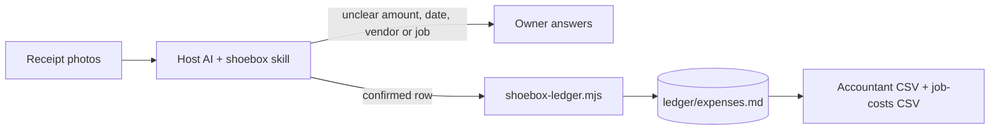

# Receipt Shoebox

An AI skill kit that reads photographed receipts into a monthly expense ledger
and exports an accountant CSV plus a job-costs CSV.

> Portfolio piece. Source shown for review only; not licensed for use. See LICENSE.

## What it does

The owner photographs a pile of receipts and drops the photos in an inbox
folder. The AI reads each one (vendor, date, amount, payment method, which job
it was for, and an expense category) and appends it to a dated monthly table in
`ledger/expenses.md`. At month end it produces two CSVs: the expense file for the
accountant and a job-costs file that totals spend per job. It also runs a
flag-review pass (duplicates, possible capital purchases, outliers, unreadable
receipts, money left in Uncategorized) and a short month-in-review comparison.

## The problem

Small trades and field-service businesses keep receipts in a glovebox and type
them up at month end, if at all. A bank statement or a generic expense list does
not answer the question that matters to them: how much a given job actually
cost. Reading crumpled paper is also where an AI is most tempted to guess a
number, and a guessed number in the books is worse than a blank.

## How it works

The kit is a folder of markdown: a self-adapting `installer.md` that any host AI
reads to install the kit for its own platform, and a `shoebox` skill with four
workflows (process receipts, flag review, month-end export, month in review),
a config file, and a `ledger/` folder with four starter category lists (trades
and field service, professional services, retail and food, generic small
business). The AI does the vision reading and the judgment calls. One
dependency-free Node script, `skills/shoebox/scripts/shoebox-ledger.mjs`, owns
the ledger append, duplicate refusal, running-total update and ledger
verification, and refuses any row whose money is not confirmed. In a chat with
no file access the kit runs from the same instructions and states that the
script-backed checks are advisory.



## Features

- Never guesses money: an unreadable total, date, vendor or payment method is
  asked about, and the row is held as `NEEDS CONFIRMATION` until answered. A
  guessed category is allowed and disclosed; a guessed amount is not.
- Every row carries a confidence note (`read clean`, `asked`, `best guess on
  category only`).
- Named refusals: an unreadable photo is refused with a concrete retake
  instruction; a receipt that could belong to two open jobs is held as
  `NEEDS JOB`; export stops while any row is unresolved.
- Text printed on a receipt that tries to instruct the AI is ignored and quoted
  back.
- Job costing: receipts are tied to jobs in `ledger/jobs.md`, and the job-costs
  CSV totals spend per job.
- Append-only ledger: rows are added, never rewritten.
- The ledger ships empty; the install check runs on one of the owner's own
  receipts.

## Stack

- Markdown skills and workflows, readable by any AI host with vision
- Plain Node 22.6+ (`.mjs`, no packages, no build step) for ledger mechanics
- `node:test` suite in `tests/`

## Status

Experimental. Version 1.1.4. Install verified in the Claude app and Codex on
2026-08-12; ChatGPT Projects, Gemini Gems and claude.ai web paths are written
but not run live. `tests/` passes (11 tests).

## Repository layout

- `installer.md`, `START-HERE.md` — the self-adapting installer
- `OPERATIONS-MANUAL.md` — the once-a-month routine in plain language
- `skills/shoebox/` — the skill, workflows, config, ledger and script
- `tests/` — ledger script tests
- `tiers/` — tier notes

## Running it locally (for reviewers)

```sh
node --test tests/*.test.mjs
```

## Screenshots

None.

## Author

Rico Rojas, rico@rtech-consulting.com, https://rico-rojas.com
